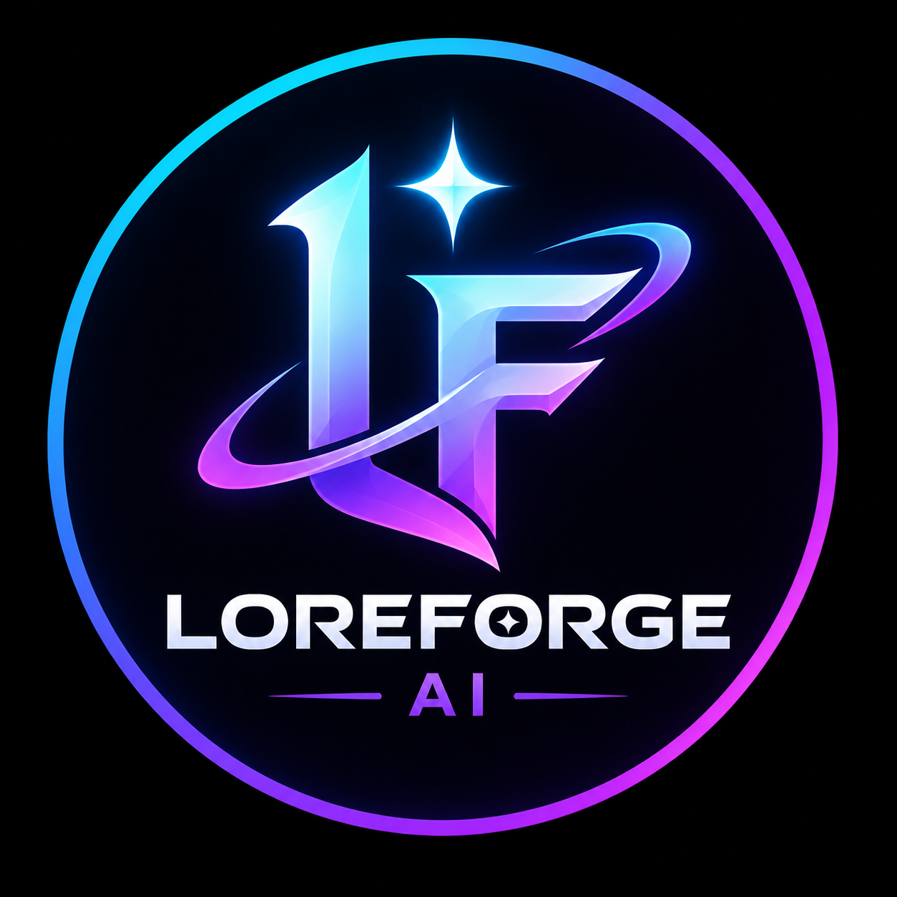
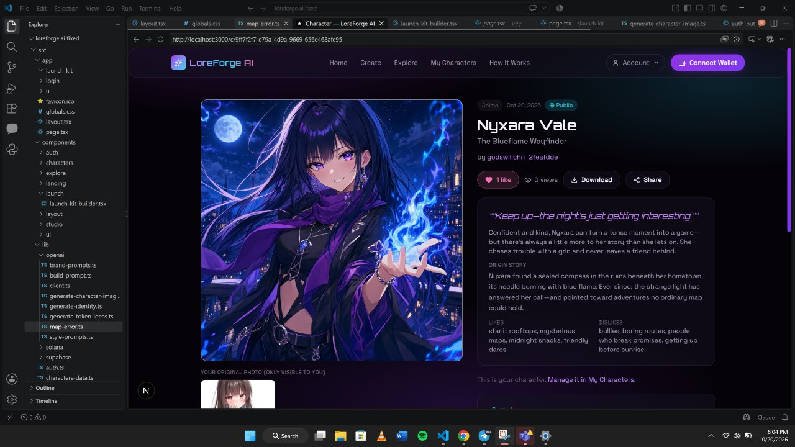
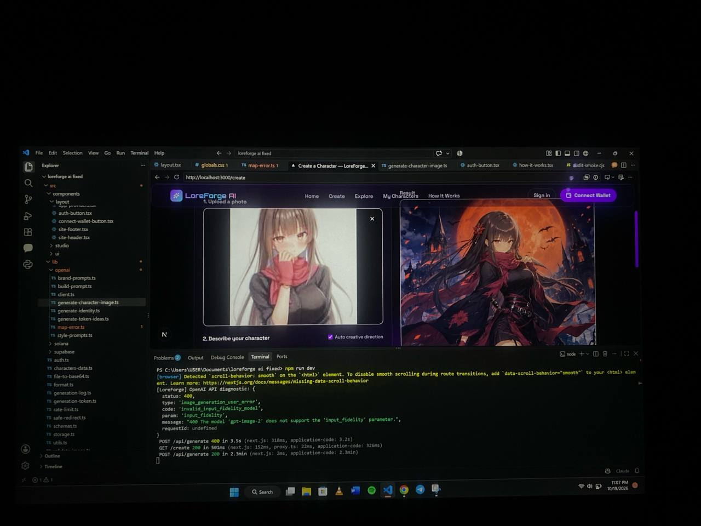

<p align="center">
  
    
    
</p>

<h1 align="center">LoreForge AI</h1>

<p align="center">
  Create original AI characters. Build their stories and brands.
  Explore character-driven memecoin projects.
</p>

<p align="center">
  Next.js · TypeScript · Supabase · OpenAI · Solana
</p>

---

## What is LoreForge?

LoreForge AI is a character-creation platform for people who want
to turn creative ideas into digital identities and memorable brands.

Create a character, develop its personality and story, generate
artwork and scenes, and prepare the branding for a character-led
memecoin project.

The long-term vision is to connect creative tools with existing
blockchain launch platforms, beginning with Solana, without trying
to become a launchpad ourselves.

## Features

### Character creation

- AI-assisted character image generation.
- Character names, personalities and backstories.
- Character-consistent scenes and additional artwork.
- Saved character collections and public character pages.

### Memecoin branding studio

- Token name and ticker brainstorming.
- Character-based token logo concepts.
- Social profile pictures and banners.
- Telegram sticker and reaction-meme assets.

### Community and discovery

- Public and private characters.
- Explore page for discovering public creations.
- Likes and views.
- Supabase authentication and storage.

### Solana token information

- Associate a character with an existing token mint address.
- Validate mint information against the Solana network.
- Display available market information when a supported data
  source has it.

Token association is not proof of wallet ownership. LoreForge
does not currently automatically launch a memecoin or create
a trading market.

## Roadmap

- [ ] Featured and trending characters based on genuine engagement.
- [ ] Character Launch Kit for preparing memecoin project materials.
- [ ] Guided handoff to supported external launchpads.
- [ ] Wallet-signature verification for creator token associations.
- [ ] Project dashboards with verified token information.
- [ ] Additional blockchain integrations based on user demand.

Roadmap items are proposals, not claims that these features are
already available.

## Technology

- Next.js App Router and React
- TypeScript
- Tailwind CSS
- Supabase Auth, PostgreSQL and Storage
- OpenAI API for AI generation
- Solana tooling for token information
- DexScreener for available market data

## Getting started

### Requirements

- Node.js compatible with the installed Next.js version
- npm
- A Supabase project
- An OpenAI API key with API access and billing enabled

### 1. Install dependencies

```bash
npm install
```
